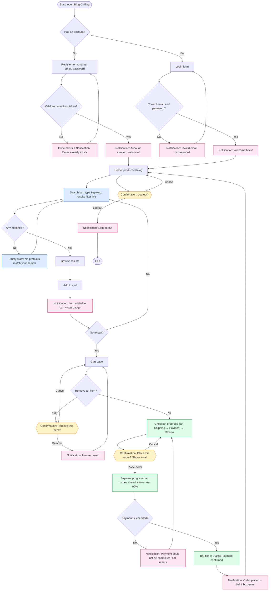

# Bing Chilling: User Flow

Shows the four HCI design patterns in the app. Paste the code block into [mermaid.live](https://mermaid.live) to render it.

Legend: **blue** = Search Bar · **green** = Progress Bar · **amber** = Confirmation · **pink** = Notification

## Demo notes
- **Accounts are temporary.** They are kept in memory only: no database and no browser storage. Refreshing the page clears all accounts and logs you out, so register again after a refresh.
- **Demo account.** `admin` / `admin` always works, as a fallback in case registration fails during a demo.
- **Per-account cart and notifications.** Each account has its own cart and bell inbox. They are kept when you log out and back in, and cleared on refresh.
- **Payment failure.** On the checkout *Review* step, tick "Demo: simulate a failed payment" to show the failure path.
